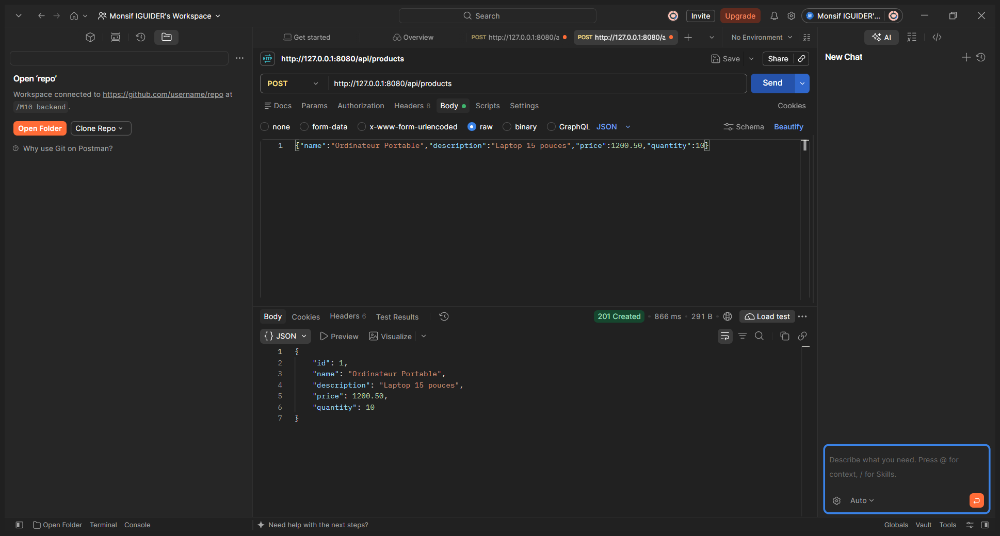
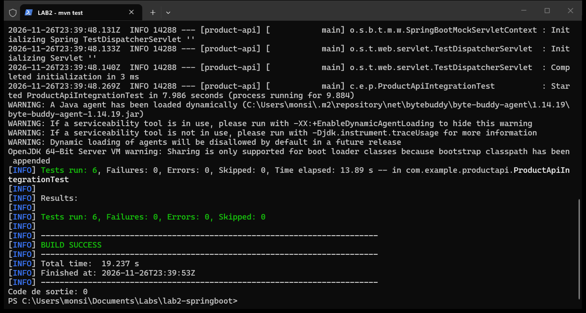

# Rapport de réalisation — LAB2

## API REST de produits avec Spring Boot

**Étudiant(e) :** ____________________

**Date de remise :** ____________________
**Projet :** [lab2-springboot](https://github.com/IguidMnsf/backend-labs/tree/main/lab2-springboot)

## 1. Objectif

Le laboratoire consiste à concevoir une API REST de gestion de produits avec Java et Spring Boot. Il met en pratique les méthodes HTTP, la séparation des responsabilités, la validation des données et la représentation des échanges en JSON.

## 2. Réalisation

L'API est organisée en couches : le contrôleur reçoit les requêtes HTTP, le service applique les règles métier et le repository gère les données. Des DTO séparent le format des requêtes et des réponses du modèle interne.

Les opérations disponibles comprennent la création, la consultation, la recherche par nom, la modification et la suppression d'un produit. Les entrées sont validées ; une quantité supérieure à 1 000 déclenche une erreur métier et un identifiant absent produit une réponse `404`.

Les produits sont conservés dans une `ConcurrentHashMap`. La conservation est temporaire : les données reviennent à l'état initial au redémarrage de l'application.

## 3. Vérifications

La commande `mvn clean verify` a été exécutée avec Java 21. Les **6 tests d'intégration ont réussi**, sans échec ni erreur. Ils couvrent les principales opérations de l'API ainsi que la recherche, la validation, la quantité maximale et la gestion d'une ressource absente.

Un essai local du point d'accès `GET /api/products` a renvoyé le statut HTTP `200`. La collection Postman du projet contient les appels de démonstration ; la requête de création initialise l'identifiant utilisé par les requêtes suivantes.

## 4. Conclusion

Le projet fournit une API Spring Boot testée, avec des routes REST, des règles de validation et une gestion cohérente des erreurs. Le stockage en mémoire convient à l'exercice, mais ne remplace pas une base de données persistante.

## 5. Captures des exécutions

**Création d'un produit dans Postman — HTTP 201 :**

**Tests automatisés — `mvn test` :**

